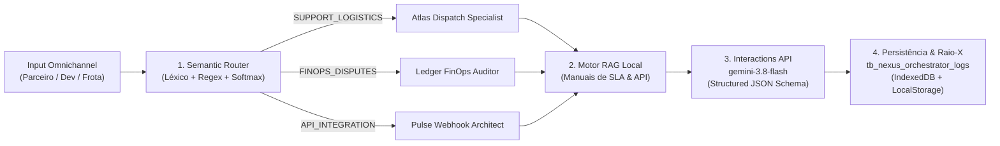

# Nexus Orchestrator — Plataforma Multi-Agente com RAG, Roteamento Semântico e Telemetria de LLM

Painel de engenharia, observabilidade e orquestração multi-agente para atendimento **Omnichannel de Delivery**, construído com **TypeScript, React, Tailwind CSS, Express e Google Gemini Interactions API (`gemini-3.8-flash` via `@google/genai`)**.

---

## 1. Visão Geral da Arquitetura

O **Nexus Orchestrator** resolve o problema de triagem de alta precisão e resposta fundamentada em políticas operacionais (SLA) em plataformas de delivery de larga escala. Cada input recebido dos canais (`PARTNER_PORTAL`, `DEVELOPER_CONSOLE`, `RIDER_APP`, `CUSTOMER_APP`) atravessa um pipeline determinístico e auditável de 4 estágios:



### Estrutura Modular do Projeto

```text
├── server/
│   └── index.ts                     # Endpoint backend Express (/api/orchestrate e /api/health)
├── src/
│   ├── domain/
│   │   ├── types.ts                 # Tipos de domínio, Zod Schema e JSON Schema oficial
│   │   └── knowledgeBase.ts         # Perfis dos 3 Sub-Agentes, Corpus RAG (9 manuais) e Cenários
│   ├── services/
│   │   ├── semanticRouter.ts        # Classificador Semântico com distribuição Softmax calibrada
│   │   ├── ragService.ts            # Recuperador Híbrido (Afinidade de Rota + Tags + TF)
│   │   └── geminiOrchestrator.ts    # Integração @google/genai (gemini-3.8-flash) + Fallback Local
│   ├── storage/
│   │   └── orchestratorStorage.ts   # Persistência híbrida na tabela tb_nexus_orchestrator_logs
│   └── ui/
│       ├── HeaderBar.tsx            # Barra superior de telemetria global e configuração de API Key
│       ├── OmnichannelSimulator.tsx # Coluna Esquerda: Chat Omnichannel e Cenários de 1-Clique
│       └── OrchestrationXRay.tsx    # Coluna Direita: Raio-X de Orquestração e Observabilidade
└── tests/
    └── orchestrator.test.ts         # Suíte de testes automatizados (Vitest)
```

---

## 2. Arquitetura do Roteamento Semântico (Semantic Router)

Implementado em [`src/services/semanticRouter.ts`](./src/services/semanticRouter.ts), o **Semantic Router** avalia a intenção do input em tempo sub-milissegundo antes de invocar o LLM, classificando em **3 rotas especializadas**:

| Rota Semântica | Sub-Agente Especialista | Escopo de Intenção & Entidades Detectadas | SLA Operacional |
| :--- | :--- | :--- | :--- |
| **`SUPPORT_LOGISTICS`** | *Atlas Dispatch & Logistics Specialist* | Extravio de pedido (`INC-LOST-IN-TRANSIT`), entregador sem sinal GPS, atraso na coleta (`READY_FOR_PICKUP`), realocação de frota, código de confirmação. | **SLA P0/P1 <= 3 min** |
| **`FINOPS_DISPUTES`** | *Ledger FinOps & Settlement Auditor* | Divergência no repasse de terça-feira (corte domingo `23:59:59`), contestação de estorno/chargeback, taxas contratuais, trava de domicílio bancário. | **SLA P1/P2 <= 15 min** |
| **`API_INTEGRATION`** | *Pulse DevPlatform & Webhook Architect* | Configuração de Webhooks (`Catalog V2`), assinatura `X-Nexus-Signature-256` (HMAC-SHA256), erros HTTP `401`/`422`/`429`, cache de token OAuth2. | **SLA P1 <= 5 min** |

### Cálculo de Probabilidade e `confidence_score`
Para cada rota $r \in \{\text{SUPPORT\_LOGISTICS}, \text{FINOPS\_DISPUTES}, \text{API\_INTEGRATION}\}$, o router calcula um score bruto $S_r$ combinando expressões compostas (n-grams), vocabulário ponderado e detectores Regex de entidades técnicas (status HTTP, endpoints REST `/v2/...`, valores monetários `R$`, IDs de pedido `#8842`). Em seguida, aplica uma distribuição **Softmax com temperatura $T = 2.8$**:

$$P(r \mid x) = \frac{\exp(S_r / T)}{\sum_{j} \exp(S_j / T)}$$

---

## 3. Camada de RAG Local (Base de Conhecimento Operacional)

Implementada em [`src/services/ragService.ts`](./src/services/ragService.ts) sobre o corpus [`src/domain/knowledgeBase.ts`](./src/domain/knowledgeBase.ts), a camada de RAG pontua os manuais técnicos e políticas de SLA da plataforma e injeta os `topK = 3` chunks mais relevantes no prompt do sub-agente:

- **`DOC-LOG-101`**: Protocolo Operacional de Extravio, Perda de Sinal GPS e Inatividade de Entregador (`INC-LOST-IN-TRANSIT`).
- **`DOC-LOG-102`**: Política de SLA de Despacho, Atraso na Coleta e Alocação Dinâmica de Frota (Surge H3 & Voucher Térmico).
- **`DOC-LOG-103`**: Manual de Devolução, Cliente Não Localizado e Código de Confirmação (Timer Geofence 10 min).
- **`DOC-FIN-201`**: Manual de Conciliação Financeira, Ciclo de Repasses de Terça-Feira e Cut-off de Domingo 23:59 BRT.
- **`DOC-FIN-202`**: Política de Contestação de Estornos, Cancelamentos Indevidos e Isenção Automática de Débito.
- **`DOC-FIN-203`**: Tabela de Taxas Contratuais, Split de Pagamento e Trava de Domicílio Bancário.
- **`DOC-API-301`**: Especificação Técnica de Webhooks de Cardápio (Catalog V2), Assinatura HMAC-SHA256 e SLA de 5000ms.
- **`DOC-API-302`**: Autenticação OAuth2 (`client_credentials`), Cache de Token (TTL 10.800s) e Rate Limiting (`HTTP 429`).
- **`DOC-API-303`**: Sincronização de Cardápio V2 e Resolução de Erros `HTTP 422 Unprocessable Entity`.

---

## 4. Camada de Inteligência (`gemini-3.8-flash` Interactions API) e Contrato JSON Schema

Em [`src/services/geminiOrchestrator.ts`](./src/services/geminiOrchestrator.ts), o sistema utiliza o SDK oficial `@google/genai` chamando a **Interactions API** (`client.interactions.create`) com o modelo **`gemini-3.8-flash`**, injetando a `system_instruction` exclusiva do sub-agente selecionado e exigindo saída estruturada via `response_format`:

```typescript
const interaction = await client.interactions.create({
  model: 'gemini-3.8-flash',
  input: compiledPrompt,
  system_instruction: systemInstruction,
  previous_interaction_id: previousInteractionId,
  response_format: {
    type: 'text',
    mime_type: 'application/json',
    schema: NEXUS_ORCHESTRATOR_JSON_SCHEMA,
  },
});
```

### Contrato JSON Schema (`NEXUS_ORCHESTRATOR_JSON_SCHEMA`)

Toda resposta do orquestrador é validada em tempo de execução pelo contrato JSON Schema e pelo parser `NexusOrchestratorOutputZodSchema`:

```json
{
  "route_matched": "SUPPORT_LOGISTICS | FINOPS_DISPUTES | API_INTEGRATION",
  "confidence_score": 0.96,
  "retrieved_documents_used": [
    {
      "doc_id": "DOC-LOG-101",
      "title": "Protocolo Operacional de Extravio, Perda de Sinal GPS e Inatividade de Entregador",
      "section": "Seção 4.2 — Entregador Incomunicável ou Desvio Crítico de Rota",
      "relevance_score": 0.98,
      "excerpt_applied": "SLA-LOG-P0: Intervenção automática após 12 min sem ping de telemetria GPS..."
    }
  ],
  "agent_response": {
    "specialist_agent": "Atlas Dispatch & Logistics Specialist",
    "summary_title": "Protocolo P0 de Extravio em Rota (INC-LOST-IN-TRANSIT) & Garantia de Repasse",
    "message": "Diagnóstico técnico detalhado fundamentado nos manuais...",
    "recommended_actions": [
      "Acionar Refazer Pedido com Prioridade P0 ou reembolso automático ao cliente.",
      "Verificar confirmação de HANDOFF_COMPLETED que blinda o repasse da loja."
    ],
    "sla_priority": "P0_CRITICAL",
    "protocol_code": "NX-LOG-2026-491820",
    "escalation_required": true
  },
  "execution_metrics": {
    "model": "gemini-3.8-flash",
    "api_version": "Interactions API v2026.05 (@google/genai)",
    "interaction_id": "int_nx_...",
    "execution_mode": "GEMINI_INTERACTIONS_API",
    "latency_ms": 218.4,
    "router_latency_ms": 1.2,
    "rag_latency_ms": 1.8,
    "llm_latency_ms": 215.4,
    "input_tokens": 642,
    "output_tokens": 284,
    "thought_tokens": 64,
    "total_tokens": 990,
    "estimated_cost_usd": 0.000305,
    "timestamp_iso": "2026-10-28T21:55:00.000Z"
  }
}
```

---

## 5. Persistência Local (`tb_nexus_orchestrator_logs`)

O módulo [`src/storage/orchestratorStorage.ts`](./src/storage/orchestratorStorage.ts) persiste todos os turnos de conversa e telemetrias na tabela `tb_nexus_orchestrator_logs` utilizando **IndexedDB** (`nexus_orchestrator_db`) com espelhamento síncrono em **LocalStorage**, permitindo filtrar execuções por rota, reabrir qualquer execução passada no Raio-X e exportar o dump JSON completo.

---

## 6. Como Executar e Testar

```bash
# 1. Instalar dependências
npm install

# 2. Executar suíte de testes automatizados (Vitest)
npm test

# 3. Iniciar interface de engenharia (Vite Dev Server)
npm run dev

# 4. Gerar build de produção (TypeScript + Vite)
npm run build
```
